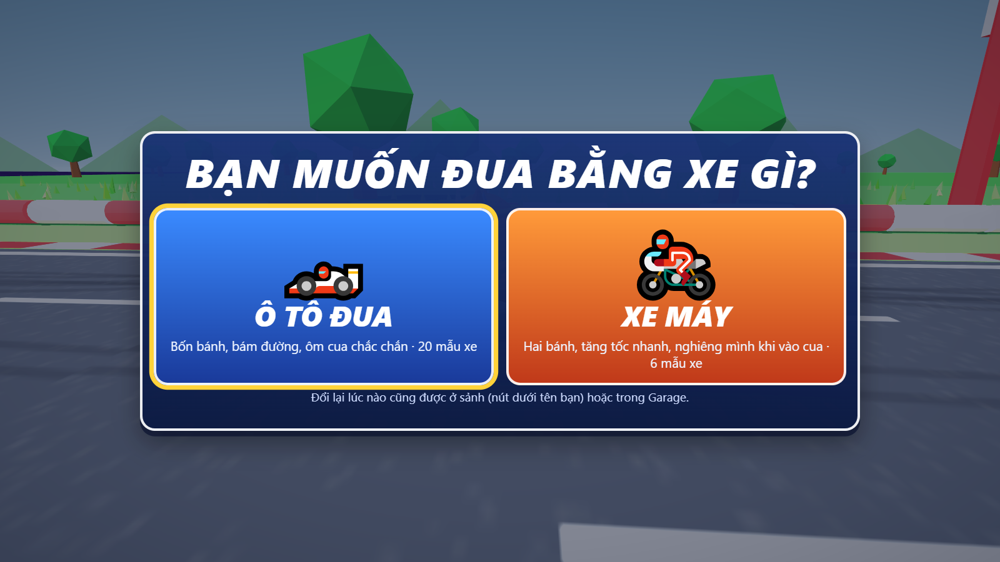
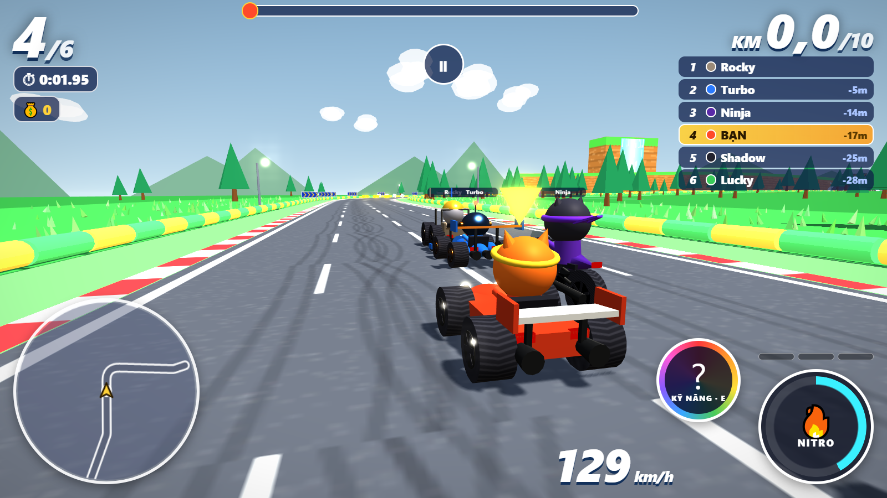
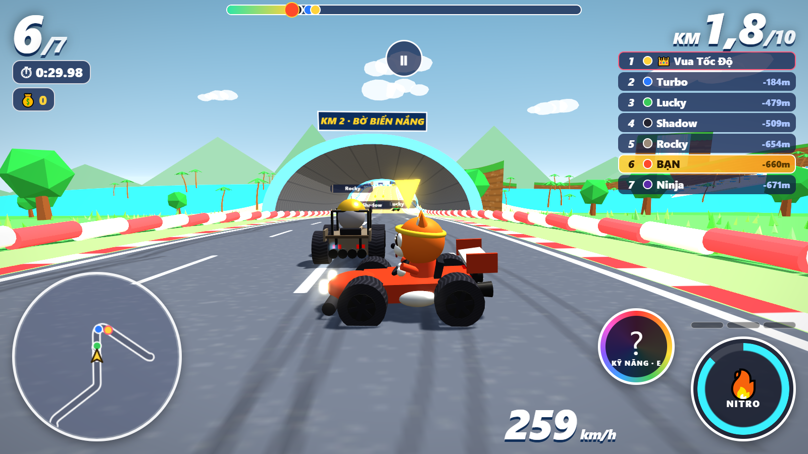
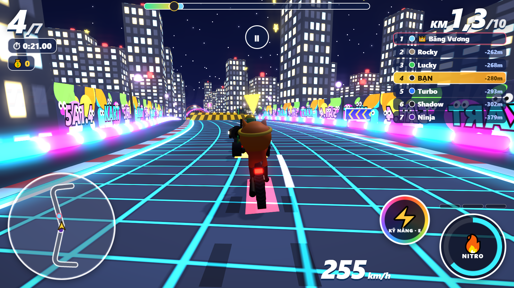
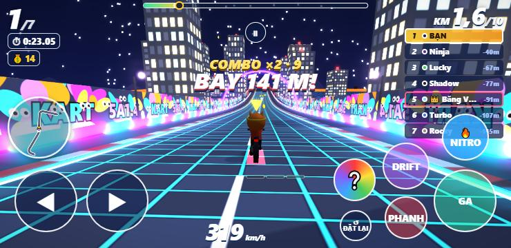

# 🏎️ Super Kart Racing

Game đua xe 3D chạy ngay trên trình duyệt, làm cho các bạn học sinh lớp 5. Chơi được trên máy tính và điện thoại (xoay ngang màn hình).

**▶ Chơi ngay:** https://lequanth08-cyber.github.io/super-kart-racing/



## Có gì trong game

- **Đua bằng ô tô hoặc xe máy**: mới vào game được chọn loại xe. Có 20 mẫu ô tô và 6 mẫu xe máy, mua bằng xu kiếm được khi đua.
- **10 đường đua, mỗi đường dài 10 km**: cứ 1 km lại chui qua đường hầm sang một khung cảnh mới, và mỗi khung cảnh có một khúc cua. Đường càng về sau cua càng gắt.
- **6 tay đua thú hoạt hình**, mỗi bạn có một lợi thế riêng, cùng 2 Boss.
- Có drift để phóng, Nitro, dốc nhảy, combo xu và hộp quà cầu vồng chứa kỹ năng làm đối thủ chậm lại.
- Có thử thách, nhiệm vụ, huy chương và bảng thành tích cá nhân.
- Cứ 15 phút game nhắc nghỉ mắt. Game không quảng cáo, không bán đồ bằng tiền thật, không bắt đăng nhập. Tiến trình chỉ lưu trên máy đang chơi.

| Khúc cua | Đường hầm sang cảnh mới | Đua bằng xe máy |
|---|---|---|
|  |  |  |

## Cách chơi

**Máy tính:**

| Phím | Tác dụng |
|---|---|
| ← → | lái |
| ↑ | ga |
| ↓ | phanh / lùi |
| Cách | giữ để drift |
| Shift | Nitro |
| E | dùng kỹ năng |
| R | đặt lại xe |
| C | đổi camera |
| Esc | tạm dừng |

**Điện thoại:**
- Đè nút ◀ ▶ để lái, trượt ngón qua lại để đổi hướng.
- Xe tự chạy ga sẵn.
- Có các nút DRIFT, NITRO, PHANH, nút kỹ năng và nút ĐẶT LẠI.



## Mã nguồn

- `index.html` là bản game hoàn chỉnh trong một tệp duy nhất.
- Mã nguồn để sửa nằm trong `src/`. Sửa xong thì dựng lại bằng:

```bash
cd src
node build.js
```

Lệnh này ghép các tệp `.js`, `khung_dau.txt` (CSS) và `khung_than.txt` (HTML) thành `index.html`.

Đồ họa 3D dùng [three.js](https://threejs.org/) r128, giấy phép MIT, nằm trong `src/three.min.js`.
