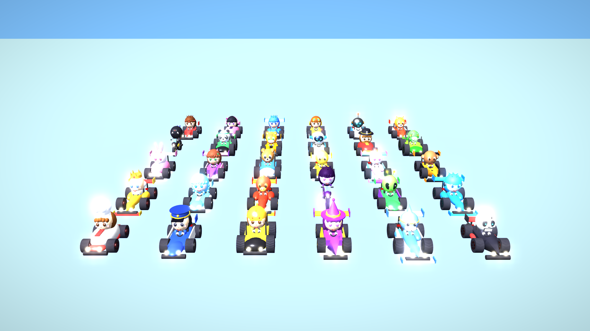
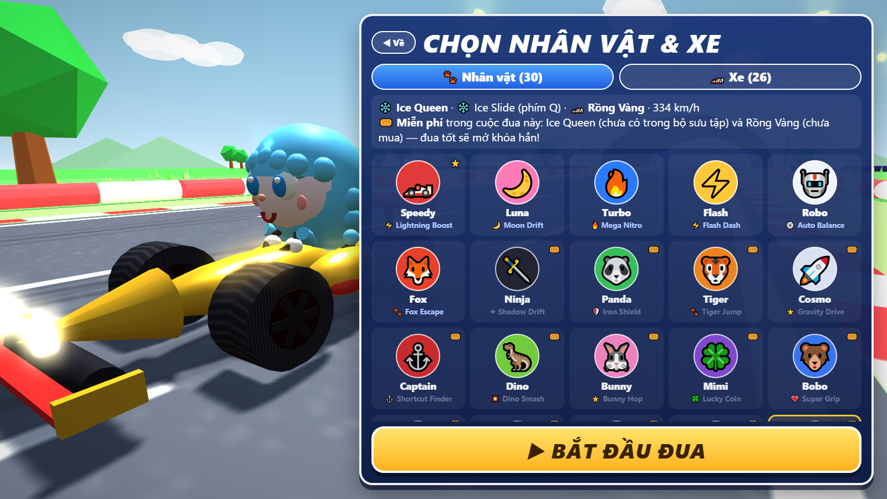
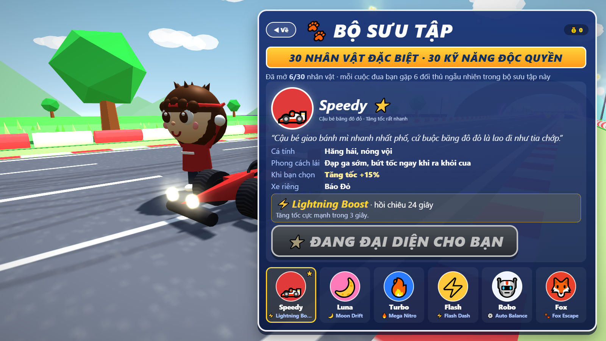
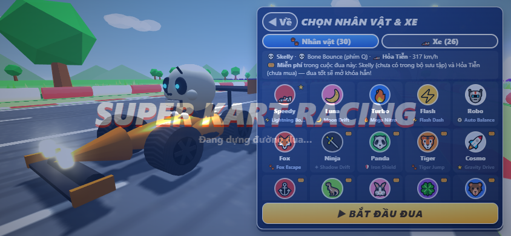

# 🏎️ Super Kart Racing

Game đua xe 3D chạy ngay trên trình duyệt, làm cho các bạn học sinh lớp 5. Chơi được trên máy tính và điện thoại (xoay ngang màn hình).

**▶ Chơi ngay:** https://superkart.22.id.vn · hoặc https://lequanth08-cyber.github.io/super-kart-racing/



## Có gì trong game

- **30 nhân vật đặc biệt · 30 kỹ năng độc quyền.** Mỗi bạn có mô hình 3D riêng (bạn nhỏ, thú, người máy, phi hành gia, khủng long, người ngoài hành tinh, bộ xương…), xe riêng, tiểu sử, cá tính, phong cách lái và một kỹ năng độc quyền bấm bằng phím **Q** (hoặc nút tròn trên điện thoại), có hồi chiêu.
- **Màn "Chọn nhân vật & xe" mỗi khi bấm Đua**: chọn được tất cả 30 nhân vật và 26 xe. Tất cả đều miễn phí: cái nào chưa có trong bộ sưu tập thì được dùng miễn phí cho cuộc đua đó, đua tốt sẽ mở khóa hẳn.
- **Bộ sưu tập nhân vật**: hiện đủ 30 bạn, bạn chưa mở khóa là bóng đen kèm điều kiện mở khóa; có hiệu ứng khi mở khóa nhân vật mới.
- **Mỗi cuộc đua có 7 xe**: bạn và 6 đối thủ máy chọn ngẫu nhiên từ bộ sưu tập, không bao giờ trùng nhau. Máy lái mỗi bạn một kiểu thật sự (drift nhiều hay ít, xài Nitro liên tục hay để dành nước rút, ôm cua sát hay rộng, chèn ép hay né…).
- **Ô tô hoặc xe máy**: có 20 mẫu ô tô và 6 mẫu xe máy, mua bằng xu kiếm được khi đua.
- **10 đường đua, mỗi đường dài 10 km**: cứ 1 km lại chui qua đường hầm sang một khung cảnh mới, và mỗi khung cảnh có một khúc cua.
- Drift để phóng, Nitro, dốc nhảy, combo xu, hộp quà cầu vồng chứa kỹ năng làm đối thủ chậm lại, thử thách, nhiệm vụ, huy chương.
- Cứ 15 phút game nhắc nghỉ mắt. Game không quảng cáo, không bán đồ bằng tiền thật, không bắt đăng nhập. Tiến trình chỉ lưu trên máy đang chơi.

| Chọn nhân vật & xe | Bộ sưu tập | Trên điện thoại |
|---|---|---|
|  |  |  |

| Khúc cua | Đường hầm sang cảnh mới | Đua bằng xe máy |
|---|---|---|
|  |  |  |

## Cách chơi

**Máy tính:**

| Phím | Tác dụng |
|---|---|
| ← → | lái |
| ↑ | ga |
| ↓ | phanh / lùi |
| Cách | giữ để drift |
| Shift | Nitro |
| E | dùng kỹ năng của hộp quà cầu vồng |
| **Q** | **kỹ năng độc quyền của nhân vật** |
| R | đặt lại xe |
| C | đổi camera |
| Esc | tạm dừng |

**Điện thoại:**
- Đè nút ◀ ▶ để lái, trượt ngón qua lại để đổi hướng.
- Xe tự chạy ga sẵn.
- Có các nút DRIFT, NITRO, PHANH, nút kỹ năng hộp quà, nút kỹ năng độc quyền (biểu tượng riêng của nhân vật) và nút ĐẶT LẠI.


## Mã nguồn

- `index.html` là bản game hoàn chỉnh trong một tệp duy nhất.
- Mã nguồn để sửa nằm trong `src/`: dữ liệu và luật (`a_hangso.js`, `a1_nhanvat.js`), đường đua (`b_duongdua.js`), mô hình xe và nhân vật (`c_xe.js`), vật lý (`d_vatly.js`), hộp quà và 30 kỹ năng độc quyền (`d2_vatpham.js`, `d3_tuyetky.js`), máy lái (`e_ai.js`), luật đua (`f_luat.js`), giao diện (`g_giaodien.js`, `khung_dau.txt`, `khung_than.txt`). Sửa xong thì dựng lại bằng:

```bash
cd src
node build.js
```

Lệnh này ghép các tệp thành `index.html`.

Đồ họa 3D dùng [three.js](https://threejs.org/) r128, giấy phép MIT, nằm trong `src/three.min.js`.
